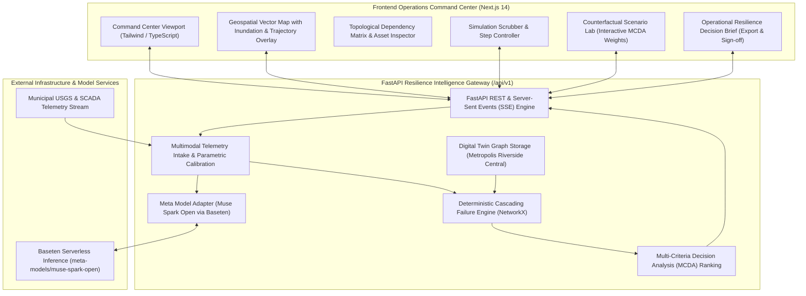

# SENTRIX — System Architecture & Technical Specifications

> **Product Tagline:** See the cascade before it happens.  
> **Hackathon Track:** Indie Developer — Push the Frontier / Build for Your World  
> **Version:** 2.4.0 (Production Hackathon Release)

---

## 1. Executive System Overview

SENTRIX is a multimodal, AI-assisted infrastructure resilience and cascading-failure intelligence platform designed for municipal emergency operations centers (EOC), infrastructure authorities, and urban resilience planners.

The system strictly decouples **qualitative multimodal reasoning** (powered by Meta Muse Spark Open via Baseten) from **quantitative physical simulation** (governed by a deterministic discrete-time graph engine implemented in NetworkX and Python).

---

## 2. Core Architectural Principles

1. **Separation of Intelligence from Calculation:**  
   Language models must never hallucinate flood heights, shortest paths, travel times, or impact metrics. The discrete-time simulation engine calculates physical outcomes deterministically. Meta Muse Spark Open interprets raw sensor evidence, extracts structured hypotheses, and explains verified simulation outputs in operational natural language.

2. **Strict Determinism:**  
   Given the same infrastructure graph, incident parameters, and scenario configuration, the simulation produces identical metric vectors and event logs across multiple runs (`random_seed=42`).

3. **No Phantom Endpoints or Slop:**  
   Every metric displayed on the dashboard originates from an active backend contract or inspected digital twin state. No mock constants are hard-coded in the UI when real simulation values exist.

4. **Defensive Model Adapter with Provenance Tracking:**  
   Calls to `meta-models/muse-spark-open` include bounded retries, generous token budgets ($\ge 2500$ tokens) accommodating reasoning tokens, exponential backoff, strict JSON validation, and deterministic fallback mechanisms that tag output provenance (`LIVE_META_MUSE_SPARK_OPEN` vs `VERIFIED_DETERMINISTIC_ENGINE`).

5. **Human-in-the-Loop Authority:**  
   SENTRIX is explicitly architected as an advisory decision-support system. All operational recommendations and deployment orders require human incident commander validation and audit logging.

---

## 3. Component Deep Dive

### 3.1 Digital Twin Graph Layer (`apps/api/sentrix/data/loader.py`)
- **Nodes ($N = 14$):** Road intersections, elevated bridges, level-1 trauma centers, community clinics, distribution substations, water pumping stations, fire/EMS dispatch, evacuation shelters, and communication towers.
- **Edges ($E = 16$):** Explicitly categorized into physical transport edges (`PHYSICAL_ROAD`, `EMERGENCY_ACCESS`) and functional dependency lifelines (`POWER_GRID`, `WATER_SERVICE`, `COMMUNICATION`).
- **Topological Integrity:** Dynamic path traversal resolves root directory relative to monorepo structure regardless of invocation path.

### 3.2 Cascading Failure Simulation Engine (`apps/api/sentrix/simulation/engine.py`)
- **Discrete-Time Intervals ($t = 0, 1, 2, 3, 4, 5$ hours):**
  - Evaluates spatial flood height:
    $$W(a, t) = \max\left(0.0, (\text{depth} + t \cdot \text{rate}) \cdot S(a) - (\text{elev}_a - 2.0) \cdot 12.0 - \text{barrier}_a\right)$$
  - Evaluates direct component failure when $W(a, t) \ge \text{threshold}_a$.
  - Fixed-point cycle-safe cascade propagation along directed dependencies; decrements backup diesel runtime ($2.0\text{h}$ for St. Jude Level-1 Trauma).
  - Dynamically computes shortest path and travel time between EMS Station 4 and St. Jude Trauma Center using Dijkstra's algorithm over passable non-inundated edges.

### 3.3 Counterfactual Scenario & Ranking Engine (`apps/api/sentrix/simulation/ranking.py`)
- Evaluates four scenarios against identical baseline conditions:
  - `BASELINE`: Unmitigated progression.
  - `ROAD_DIVERSION`: Early perimeter closure and activation of elevated Northway Ridge emergency corridor.
  - `SUBSTATION_BARRIER`: Rapid Tiger Dam flood barrier and dewatering pump deployment at Substation North-01.
  - `COMBINED_MITIGATION`: Multi-vector synchronized response.
- Computes normalized Multi-Criteria Decision Analysis (MCDA) score ($0-100$) across 6 weighted dimensions:
  1. Critical Asset Protection (default: 35%)
  2. Total Impact Reduction (default: 30%)
  3. Road Network Accessibility (default: 15%)
  4. Access Delay Minimization (default: 10%)
  5. Execution Feasibility (default: 5%)
  6. Resource Cost Efficiency (default: 5%)
- Supports live interactive weight preset tuning ("Balanced Strategy", "Life-Safety Priority", "Rapid Transit Focus").

---

## 4. API Surface Overview

| Endpoint | Method | Description |
| :--- | :--- | :--- |
| `/api/v1/health` | `GET` | Health check and Baseten model endpoint connectivity status |
| `/api/v1/infrastructure/graph` | `GET` | Metropolis digital twin topology, nodes, lifelines |
| `/api/v1/infrastructure/assets/{id}` | `GET` | Inspect single asset metadata, dependencies, and state |
| `/api/v1/scenarios` | `GET` | List configured municipal incident scenarios |
| `/api/v1/simulations` | `POST` | Execute discrete-time cascading failure simulation |
| `/api/v1/simulations/{id}` | `GET` | Fetch cached simulation run result |
| `/api/v1/simulations/{id}/events` | `GET` | Server-Sent Events (SSE) stream of timeline step events |
| `/api/v1/interventions/compare` | `POST` | Counterfactual comparison & MCDA ranking |
| `/api/v1/intelligence/analyze` | `POST` | Multimodal incident intake reasoning via Meta Muse Spark Open |
| `/api/v1/intelligence/explain` | `POST` | Operational explanation and trade-off analysis |
| `/api/v1/decision-brief` | `POST` | Generate RFC-3339 audit decision brief for Incident Commander |
