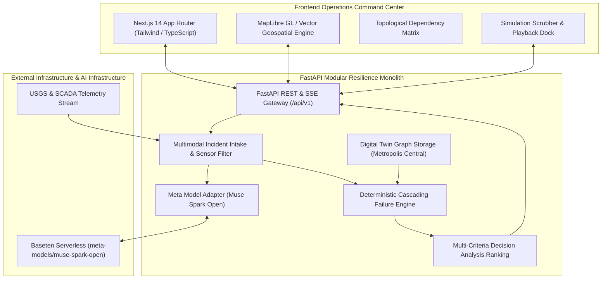

# SENTRIX — System Architecture & Technical Specifications

> **Product Tagline:** See the cascade before it happens.  
> **Hackathon Track:** Indie Developer — Push the Frontier / Build for Your World  
> **Version:** 2.4.0 (Production Hackathon Baseline)

---

## 1. Executive System Overview

SENTRIX is a multimodal, AI-assisted infrastructure resilience and cascading-failure intelligence platform designed for municipal emergency operations centers (EOC), infrastructure authorities, and urban resilience planners.

The system decouples **qualitative multimodal reasoning** (powered by Meta Muse Spark Open via Baseten) from **quantitative physical simulation** (governed by a deterministic discrete-time graph engine implemented in NetworkX and Python).

---

## 2. Architectural Principles

1. **Separation of Intelligence from Calculation:**  
   AI models must never invent flood heights, shortest paths, travel times, or impact metrics. The discrete-time simulation engine calculates physical outcomes deterministically. Meta Muse Spark Open interprets raw sensor evidence, extracts structured hypotheses, and explains verified simulation outputs.

2. **Strict Determinism:**  
   Given the same infrastructure graph, incident parameters, and scenario configuration, the simulation produces identical metric vectors and event logs.

3. **No Phantom Endpoints or Slop:**  
   Every metric displayed on the dashboard originates from an active backend contract or inspected digital twin state.

4. **Defensive Model Adapter with Provenance Tracking:**  
   Calls to `meta-models/muse-spark-open` include bounded retries, exponential backoff, strict JSON validation, and fallback mechanisms that flag output provenance (`LIVE_META_MUSE_SPARK_OPEN` vs `VERIFIED_DETERMINISTIC_ENGINE`).

---

## 3. Core Component Breakdown

### 3.1 Digital Twin Graph Layer (`apps/api/sentrix/data/loader.py`)
- **Nodes ($N = 14$):** Road intersections, elevated bridges, level-1 trauma centers, community clinics, distribution substations, water pumping stations, fire/EMS dispatch, evacuation shelters, and communication towers.
- **Edges ($E = 16$):** Explicitly categorized into physical transport edges (`PHYSICAL_ROAD`, `EMERGENCY_ACCESS`) and functional dependency lifelines (`POWER_GRID`, `WATER_SERVICE`, `COMMUNICATION`).

### 3.2 Cascading Failure Simulation Engine (`apps/api/sentrix/simulation/engine.py`)
- **Discrete-Time Intervals ($t = 0, 1, 2, 3, 4, 5$ hours):**
  - Evaluates spatial flood height: $W(a, t) = \max(0.0, (\text{depth} + t \cdot \text{rate}) \cdot S(a) - (\text{elev}_a - 2.0) \cdot 12.0 - \text{barrier}_a)$.
  - Evaluates direct component failure when $W(a, t) \ge \text{threshold}_a$.
  - Propagates power failure along directed graph; decrements backup diesel runtime ($2.0\text{h}$ for St. Jude).
  - Dynamically computes shortest path and travel time between EMS Station 4 and St. Jude Trauma Center using Dijkstra's algorithm.

### 3.3 Counterfactual Scenario & Ranking Engine (`apps/api/sentrix/simulation/ranking.py`)
- Evaluates four scenarios against identical baseline conditions:
  - `BASELINE`: Unmitigated progression.
  - `ROAD_DIVERSION`: Early perimeter closure and activation of elevated Northway Ridge emergency corridor.
  - `SUBSTATION_BARRIER`: Rapid Tiger Dam flood barrier and dewatering pump deployment at Substation North-01.
  - `COMBINED_MITIGATION`: Multi-vector synchronized response.
- Computes normalized Multi-Criteria Decision Analysis (MCDA) score ($0-100$) across 6 weighted dimensions.

---

## 4. Security & Safety Architecture

- **Zero Credential Exposure:** Secrets reside exclusively in `.env` (gitignored). Never printed in logs, responses, or client bundles.
- **Untrusted Model Output:** AI outputs are treated as untrusted text; never passed into SQL, `eval()`, shell executors, or code dispatchers.
- **CORS & Rate Limiting:** Enforced at FastAPI gateway level.
- **Audit Trails:** Every decision brief generates an RFC-3339 timestamped audit record requiring explicit human operator validation sign-off.
